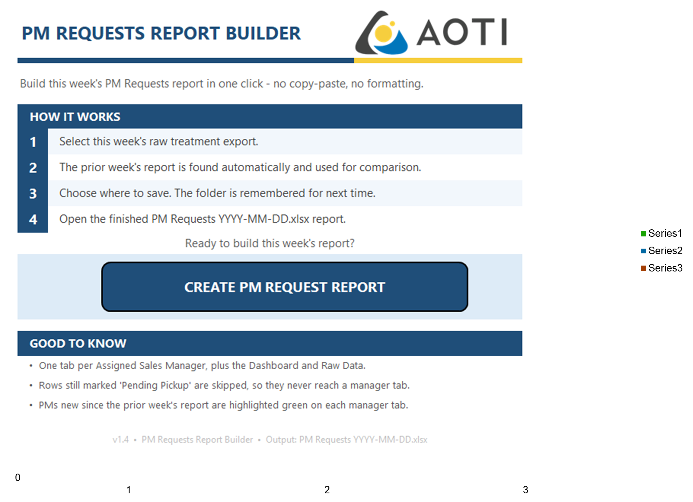
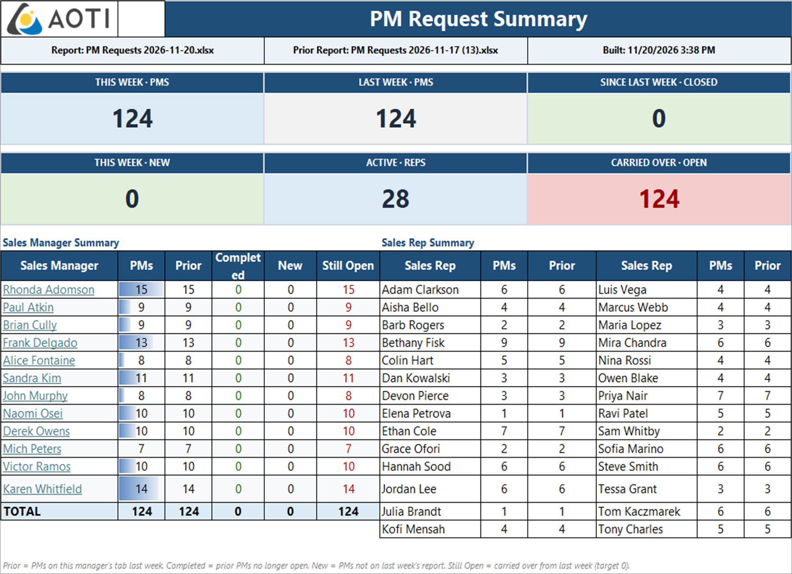
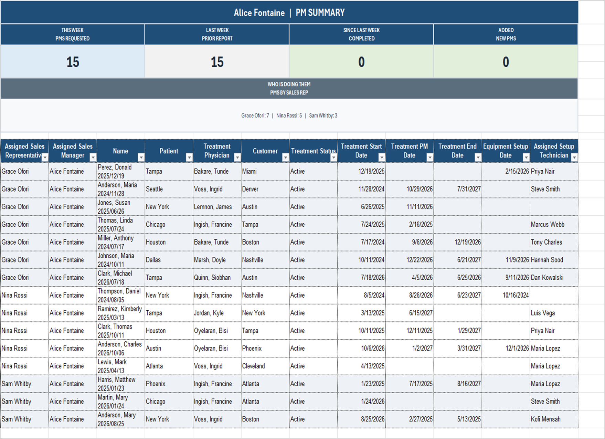
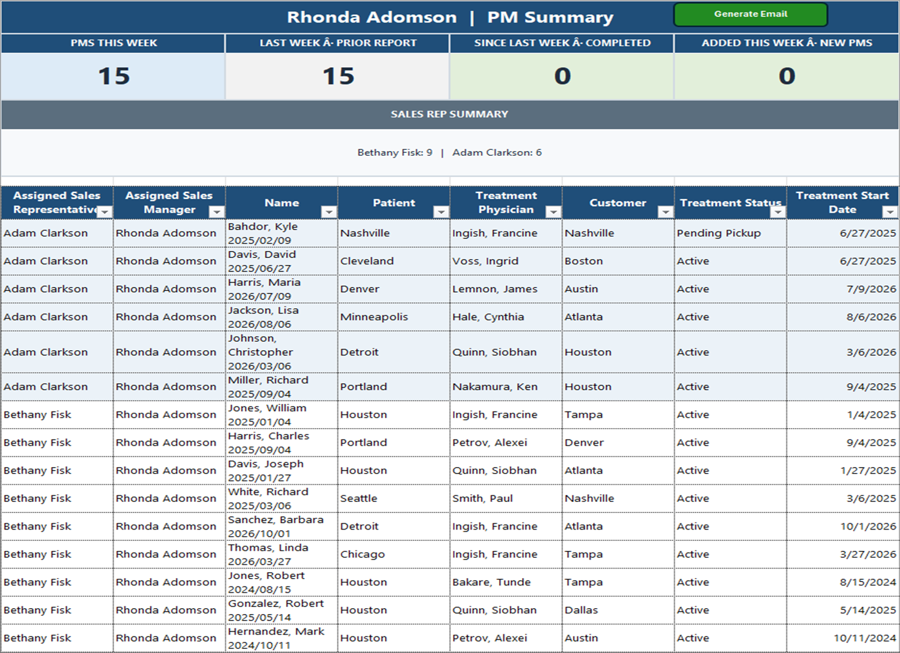

# PM Requests Report Builder

One click turns the weekly treatment export into a finished, formatted **PM Requests**
workbook: a KPI **Dashboard**, one tab per **Sales Manager**, and the **Raw Data** - with
the prior week's report compared automatically.



**Version 1.4** | Excel + VBA (desktop) | Windows and macOS | No add-ins, no install

---

## Work-PC build (macro-blocked machines)

Download Project-Local-Build.zip from the repo, extract, and follow BUILD-INSTRUCTIONS.txt.
The ZIP contains a macro-free PM_Requests_Master_Template_(No Macros).xlsx plus all VBA modules;
import them via Alt+F11 -> File -> Import File..., then Save As .xlsm.
This avoids Windows/Org "Microsoft has blocked macros" issues on locked-down machines.
## Contents

- [Why this exists](#why-this-exists)
- [What the report contains](#what-the-report-contains)
- [Quick start](#quick-start)
- [The weekly run, step by step](#the-weekly-run-step-by-step)
- [The Dashboard](#the-dashboard)
- [Manager tabs](#manager-tabs)
- [Prior-week comparison](#prior-week-comparison)
- [Source file requirements](#source-file-requirements)
- [Logging and diagnosing a stuck run](#logging-and-diagnosing-a-stuck-run)
- [Repository layout](#repository-layout)
- [VBA architecture](#vba-architecture)
- [Development: the mandatory loop](#development-the-mandatory-loop)
- [The compile gate](#the-compile-gate)
- [Testing](#testing)
- [Cross-project audit](#cross-project-audit)
- [Troubleshooting](#troubleshooting)
- [Known limitations](#known-limitations)
- [Changelog](#changelog)

---

## Why this exists

Every week someone exported treatment data, then hand-built the same workbook: filter out
the rows that are not PM work, split what is left by Sales Manager, rebuild the KPI cards,
re-colour the headers, and work out what changed since last week. That was an hour of
copy-paste that produced a slightly different file every time.

This workbook makes it deterministic: one button, one input file, one output file, and a
log that says exactly what happened.

---

## What the report contains

The generated workbook has three kinds of sheet, in this order:

| # | Sheet | Contents |
|---|---|---|
| 1 | **Dashboard** | Six KPI cards, a hyperlinked manager table, a Sales Rep grid, a bar chart, the logo, and a footnote naming the source and prior files. |
| 2..n | **One tab per Sales Manager** | Banner, four KPI cards, a full-width "PMs by Sales Rep" card, and the manager's rows in a filterable, banded table. Sorted by manager **last** name. |
| n+1 | **Raw Data** | The source export, copied verbatim, as the last tab. |

Rows that are not PM requests are classified, counted in the log, and left out of the
report - see [Source file requirements](#source-file-requirements).

---

## Quick start

1. Open `PM_Requests_Master_Template.xlsm` in desktop Excel.
2. If the yellow bar says macros are disabled, click **Enable Content** (or set
   **File > Options > Trust Center > Trust Center Settings > Macro Settings**).
3. Go to the **START HERE** sheet and click **CREATE PM REQUEST REPORT**.
4. Pick the current raw export (`.xlsx`, `.xlsm`, `.xlsb`, `.xls`).
5. The first run asks where to save reports. That folder is remembered in the very-hidden
   `PM Settings` sheet and reused from then on.
6. The finished report opens on its Dashboard, saved as `PM Requests YYYY-MM-DD.xlsx`.

The button is a self-repairing form control: `SetupReportButton` runs at the start of every
build and re-creates `btnCreatePMReport` if it is missing or broken, so a deleted button is
never a support call.

---

## The weekly run, step by step

| Step | What happens | What can go wrong |
|---|---|---|
| 1 | You pick the raw export. | Picking the master workbook itself is rejected with a clear message. |
| 2 | The prior report is found **automatically** in the remembered output folder (newest report with enough name overlap). Nothing to pick. | No prior report is fine: prior-based cards show 0 and no comparison is done. |
| 3 | The macro scans the first 30 rows of every sheet for `Assigned Sales Manager` and `Treatment Status`, then loads the whole used range into `Raw Data`. | Missing header -> "Could not find a worksheet containing both required headers". |
| 4 | Rows are classified: assigned + a PM-request status = a PM request, grouped by manager. | No rows -> "The selected raw-data file has no data rows". |
| 5 | Manager tabs are built, sorted by last name, formatted, filtered, frozen. | - |
| 6 | Dashboard is built and moved to the front; `Raw Data` is copied last; tabs are coloured; the window is maximized on the Dashboard at 90% zoom. | - |
| 7 | Saved as `PM Requests YYYY-MM-DD.xlsx`; a numbered name `(2)`, `(3)` is used if that file exists. Nothing is ever overwritten. | Folder missing -> you are asked for a replacement. |

The source export is opened **read-only** and closed without saving. The master workbook is
never modified except for its remembered output-folder setting.

A typical run on the 124-row test export takes **~4.4 s**, of which the Dashboard is the
slowest single step (~0.7 s).

---

## The Dashboard



Six KPI cards, each with a label, a big number, and a caption:

| Card | Caption | Meaning |
|---|---|---|
| **PMs This Week** | TOTAL | Rows written to manager tabs. |
| **Prior Report** | LAST WEEK | PMs on the prior report's manager tabs. |
| **Completed** | SINCE LAST WEEK | On the prior report, not on this one. |
| **New PMs** | ADDED THIS WEEK | On this report, not on the prior one. |
| **Sales Reps** | DOING THEM | Distinct names across the manager tabs. |
| **Still Open From Prior** | - | Prior PMs still present this week. |

Below the cards: two section labels, then a **Sales Manager** table
(`Sales Manager | PMs | Prior | Completed | New | Still Open`) whose manager cells are
hyperlinks to their tabs, and a **Sales Rep** grid (`Sales Rep | PMs | Prior`) in two
three-column blocks. Rows with open work are shown in dark red; the `PMs` column carries
data bars. A clustered column chart (**PMs by Sales Manager**, 900 x 280 pt) sits to the
right, and a footnote names the source file and the prior file.

---

## Manager tabs



Every manager tab has the same anatomy, so a reader always knows where to look:

| Rows | Content |
|---|---|
| 1 | Banner: manager name. |
| 2-4 | Four KPI cards: **PMs Requested** (THIS WEEK), **Prior Report** (LAST WEEK), **Completed** (SINCE LAST WEEK), **New PMs** (ADDED). |
| 5-7 | Full-width **PMs BY SALES REP** card: who is doing them, with prior counts. |
| 8 | Spacer. |
| 9 | Table header. |
| 10+ | Data, with an AutoFilter and a frozen header row. |

Formatting rules: per-employee alternating row banding (white / `RGB(238,241,245)`), rows
for PMs who are new since the prior report in light green **and bold**
(`RGB(226,239,218)`), every column set to a fixed 16-character width, thin
`RGB(210,218,226)` borders around the table with white row separators, an AutoFilter, a
frozen header row, and landscape fit-to-one-page-wide printing with row 9 repeating.

Managers are sorted by **last name**, and both `Last, First` and `First Last` name formats
are understood.

---

## Prior-week comparison

Comparison is **name-based**, not ID-based:

- A PM is **completed** when their name is on the prior report and not on this one.
- A PM is **new** when their name is on this report and not on the prior one.
- The prior report is opened **read-only**, never modified, and never re-saved.

Auto-detection looks for `PM Requests *.xlsx` in the remembered output folder and picks the
newest by name overlap. Reports stored elsewhere must be moved into that folder or passed
explicitly by automation.

---

## Source file requirements

The export must contain one worksheet with these two headers (case-insensitive, trimmed;
the header row can be anywhere in the first 30 rows):

- **Assigned Sales Manager**
- **Treatment Status**

Every other column is carried into the report as supplied: original order, original values,
original header and number formats (formats are copied row by row, because `Value2` alone
loses date and number formats).

One data rule decides what a PM request is: a row counts when **Assigned Sales Manager**
is non-empty. **Treatment Status** is still required in the export and carried into the
report, but it no longer filters anything - every row with a manager is a PM request.
Rows without a manager are counted in the run log (`skipped=0` on the test fixture) and
left out of every tab, KPI card and count; the completion message repeats the number so it
is never silently lost. The fixture therefore produces **124 PMs across 12 managers**.

---

## Logging and diagnosing a stuck run

Every build writes one log next to the master workbook:

```
Logs\PM_Report_20261113_235546.log
```

Every line is `yyyy-MM-dd hh:mm:ss  +<ms since previous line>ms  message`, so a hang is one
line followed by silence - and the line *before* the silence is the step that hung:

```
2026-11-14 00:28:49  +0000ms  manager tab 9/12: Derek Owens (10 rows)
2026-11-14 00:28:49  +0249ms  manager tab done: Derek Owens
2026-11-14 00:28:50  +0000ms  [stage] manager tabs
2026-11-14 00:28:51  +0000ms  [stage] dashboard
2026-11-14 00:28:51  +0683ms  [stage] dashboard moved
2026-11-14 00:28:51  +0000ms  [stage] saved
2026-11-14 00:28:51  +0013ms  SUMMARY: saved=...\PM Requests 2026-11-14 (2).xlsx  pmTotal=124  managers=12  newPMs=36  skipped=0
2026-11-14 00:28:51  +0001ms  === RUN OK in 4.5s
```

Errors are logged as `!!! ERROR <number>: <description>   [stage: ...]`.

**Stage labels**, in run order: `fastmode`, `source open`, `raw load`, `data read`,
`collections set`, `classified`, `detect prior`, `out workbook`, `manager tabs`,
`dashboard`, `dashboard moved`, `raw copied`, `tabs colored`, `view set`, `saved`.

### The 10-second watchdog

```powershell
.\scripts\run-report.ps1
```

Starts a headless build, follows the log, and enforces a stall limit: **no new log line for
10 seconds** means the run is stuck. Excel and the worker are killed, the last 40 log lines
are printed with the slowest step called out, and the script exits `2`. A clean run prints
`RESULT=OK|...` and exits `0`.

The usual causes, in the order the log shows them: a modal dialog Excel is waiting on
(macro-security prompt, file picker, a `MsgBox` left in the code), a compile-error dialog,
or one very large copy (`raw load`, `dashboard`).

### `/logs`

The `/logs` slash command prints every run log oldest-first (newest at the bottom) plus a
table of the slowest steps across the last five runs. `/logs 20261113` narrows it to one
day.

---

## Repository layout

| Path | Role |
|---|---|
| `PM_Requests_Master_Template.xlsm` | The master workbook: embedded VBA, `START HERE`, very-hidden `PM Settings`. This is what users open. |
| `PM_Report_Macro.bas` | **Canonical VBA source.** The embedded module is synced from here; never edit the module inside the `.xlsm`. |
| `AOTIOpsTreatmentPMDatesResults_FAKE.xlsx` | Synthetic export (124 rows, 12 managers) used for regression tests. |
| `documentation/` | `AGENTS.md` (rules), `CHANGELOG.md`, `screenshots/`, logo art. |
| `documentation/AGENTS.md` | The rules any agent or contributor must follow. |
| `scripts/` | All tooling: PowerShell harnesses and two Python fixture generators. |
| `Logs/` | One run log per build, plus the dialog watcher log. Safe to delete; not committed. |
| `Reports/` | Generated reports. Not committed. |
| `backups/` | At most two master snapshots, taken only when the module actually changes. |
| `.kilo/command/` | `/logs` and `/audit` slash commands. |

### Scripts

| Script | Purpose |
|---|---|
| `sync_template.ps1` | Imports the `.bas` into the master's VBA project and rebuilds `START HERE`. Run after every `.bas` change. Takes one backup first. |
| `test-compile.ps1` | Compile gate: imports the `.bas` into a copy of the master, triggers **Debug > Compile VBAProject** (compiles *every* procedure), then runs an execution probe. `-SelfTest` proves the detector detects. |
| `run-report.ps1` | Headless end-to-end build with the stall watchdog described above. |
| `build-worker.ps1` | The headless worker `run-report.ps1` starts (one Excel instance, one `RunReport` call). |
| `watch-compile-error.ps1` | Stands outside Excel, records and dismisses every modal dialog into `Logs\watcher.log`. |
| `answer-dialogs.ps1` | Answers the real UI path's dialogs (source picker, output folder, final `MsgBox`) so the button can be exercised unattended. |
| `audit-peer.ps1` | Read-only cross audit against the sibling project (see below). |
| `snapshot-report.ps1` | Exports sheets as PNG images (these screenshots) for docs and design comparison. |
| `dump-sheet.ps1` | Read-only structural dump of one sheet (merges, widths, heights, fonts, fills, shapes) for verifying layouts. |
| `check-toc.ps1` | Verifies the MAP block at the top of `PM_Report_Macro.bas` (section start lines and procedure names) against the file. `-Fix` rewrites it. |
| `make_fake_data.py` | Regenerates the synthetic export. |
| `make_prior.py` | Builds a prior-week report for comparison tests. |

---

## VBA architecture

All VBA lives in the single standard module **`PM_Report_Macro`** (`Option Explicit`
throughout). Constants sit in the declarations section at the top of the module and define
the file names, headers, and UI text - change those to rebrand.

| Group | Members |
|---|---|
| Entry points | `BuildManagerTabs` (pipeline), `SetupReportButton`, `RebuildStartSheet` |
| `START HERE` canvas | `GetOrCreateStartSheet`, `AddStartStep`, `AddStartBullet`, `PositionStartLogo` |
| Pipeline | `RunReport`, `FindSourceWorksheet`, `FindHeaderRow`, `FindHeaderColumn`, `LoadSourceIntoRawData` |
| Classification | `BuildOutputArray`, `SortManagersByLastName`, `LastNameKey`, `SafeSheetName` |
| Prior comparison | `DetectPriorReport`, `PriorNameOverlap`, `SortPathsNewestFirst`, `LoadPriorComparison`, `PriorNameExists`, `NormalizeName`, `CountDiff` |
| Dashboard | `BuildDashboard`, `AddManagerChart`, `WriteTableHeader`, `AddPolishedCard`, `AddPolishedTextCard`, `AddDashboardLogo` |
| Manager formatting | `FormatManagerSheet`, `ApplyReaderFriendlyFormatting`, `CountInSheet` |
| Output helpers | `GetUniqueOutputPath`, `GetRememberedOutputFolder`, `SaveOutputFolder`, `RestoreExcelState` |
| Diagnostics | `LogOpen`, `LogLine`, `LogStage`, `LogPath`, `SetStatus` |

---

## Development: the mandatory loop

Any change to `PM_Report_Macro.bas` goes through this loop, in this order:

```powershell
.\scripts\test-compile.ps1     # 1. whole-project compile gate (seconds)
.\scripts\sync_template.ps1    # 2. import into the master, rebuild START HERE
.\scripts\run-report.ps1       # 3. end-to-end build against the fake export
```

Expected result of step 3:

```
RESULT=OK|C:\...\Reports\PM Requests 2026-11-14 (2).xlsx|124|0|PM Requests 2026-11-07.xlsx
```

That is `OK | output path | PMs | skipped-without-manager | prior
report`. Anything else is a bug.

Then: read the log, kill any stray `EXCEL` process, and update `documentation/CHANGELOG.md`.

---

## The compile gate

Excel's compile-on-demand means **running a procedure does not compile its neighbours**: a
typo in a procedure nobody calls survives every `Application.Run`. Compile errors surface as
modal dialogs (`0x800A03E8` / `0x800706BE`), never as exceptions, so a headless harness sees
a hang rather than a message.

`test-compile.ps1` therefore triggers the real **Debug > Compile VBAProject** command (VBE
command bar, Debug menu, control id 578), which compiles every procedure in every module.
A pass requires three things, not one:

1. the compile command was found and executed (it refuses to report "clean" if the control
   is missing or disabled),
2. no error dialog appeared, and
3. the execution probe ran and wrote its marker.

`watch-compile-error.ps1` runs alongside, polling every 100 ms, and writes each dialog's
full text to `Logs\watcher.log` before dismissing it. `-SelfTest` injects a deliberately
broken procedure, asserts the gate **fails**, verifies the fixture really is in the module,
removes it, and asserts the gate passes - because a fixture that was never saved once
produced a false pass here.

---

## Testing

| Check | Command | Expected |
|---|---|---|
| Whole-project compile | `.\scripts\test-compile.ps1` | `RESULT: COMPILE OK` |
| Detector self-test | `.\scripts\test-compile.ps1 -SelfTest` | `SELFTEST: injected error detected as expected` |
| End-to-end build | `.\scripts\run-report.ps1` | `RESULT=OK\|...\|124\|0\|<prior>` |
| Visual regression | `.\scripts\snapshot-report.ps1` | PNGs in `documentation\screenshots\` |

The fixture is `AOTIOpsTreatmentPMDatesResults_FAKE.xlsx`: 124 rows, 12 managers, all 124
counted as PMs. Build once, then `python scripts\make_prior.py` writes last week's report, and
the next build reports `newPMs=36`.

---

## Cross-project audit

A sibling project, **Pending Pickup Report Builder**, shares this harness design and the
Excel/VBA techniques but works on different data. `/audit` runs a read-only comparison of
the two:

- files only one side has, and files that differ (with the functions or Markdown sections
  each side adds),
- VBA procedure names: shared vs peer-only,
- PowerShell/Python function names and Markdown section headings.

```powershell
.\scripts\audit-peer.ps1                              # all sections
.\scripts\audit-peer.ps1 -Sections scripts,commands   # narrow it
.\scripts\audit-peer.ps1 -Report documentation\cross-audit.md
```

The peer is auto-discovered (a sibling directory with a root `*.bas` and a `scripts\`
folder); `-PeerPath` overrides it. The same two files exist in the peer, so the audit runs
correctly from either side. The audit never writes to either project.

---

## Troubleshooting

| Symptom | Cause / fix |
|---|---|
| "Could not find a worksheet containing both required headers" | The export lacks `Assigned Sales Manager` or `Treatment Status`, the header is below row 30, or the spelling/spacing differs. Fix the export. |
| "The selected raw-data file has no data rows" | Header found, nothing below it. |
| "The selected raw-data file is the PM Requests master workbook" | You picked the `.xlsm` itself. Pick the export. |
| Button or macro does nothing | Macros are disabled. See [Quick start](#quick-start). |
| Build hangs with no error | A modal dialog is waiting. Check `Logs\watcher.log` and the run log's last line. |
| Wrong output folder | Clear `PM Settings!B2` (very-hidden sheet) and run again. |
| Extra columns or blank rows in output | The macro uses the source's last used row/column; remove stray formatting or junk rows in the export. |
| Report looks unformatted | Formatting runs under `On Error Resume Next`; check the run log for the `dashboard`/`manager tabs` stages. |

---

## Known limitations

- Comparison is **name-based**: a PM whose `Name` changed between weeks counts as one
  completed plus one new PM.
- Prior-report auto-detection only looks at `PM Requests *.xlsx` in the remembered output
  folder.
- macOS has no folder picker: the output path is typed into an `InputBox`.
- Rows with no Assigned Sales Manager are counted in the log but not reported in the workbook.

---

## Changelog

See [documentation/CHANGELOG.md](documentation/CHANGELOG.md). Current version **1.4**; every
change is logged there with a `YYYY-MM-DD HH:mm:ss` timestamp.

## Rules for contributors and agents

[documentation/AGENTS.md](documentation/AGENTS.md) is the canonical rule set: the one true
VBA source, the mandatory compile/sync/run loop, Excel handling rules, the logging format,
the file layout, and version control.

## Sample Manager Tab


